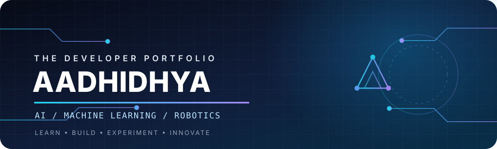

# Hi, I'm Aadhidhya 👋

**B.Tech Artificial Intelligence & Machine Learning Student**  
Sri Eshwar College of Engineering · Batch 2029

I enjoy building practical projects where **AI, software and robotics** meet.

## About me

- 🎓 AI & ML undergraduate, interested in applied machine learning and software engineering.
- 👁️ Exploring computer vision, object detection and image processing.
- 🤖 Building robotics prototypes with ESP32, sensors, motor control and robotic arms.
- 💻 Practising Python, C, C++, Java and problem-solving.
- 🌱 Learning by building, testing, documenting and improving projects.

## Technologies

**Programming**

**AI, computer vision and robotics**

**Web, databases and tools**

## Featured projects

### 1. CivicLens AI — Smart Waste Management

An ongoing robotics project exploring AI-assisted waste collection and sorting. The software combines YOLO-based waste detection, wireless ESP32 control, a 4WD robot platform and robotic-arm experiments. A separate ROS 2 / Gazebo repository contains the simulation work.

- **Focus:** computer vision, embedded control, robotics and automation.
- **Repositories:** [ML-TRUCK](https://github.com/aadhidhyas01-spec/ML-TRUCK) · [ROS 2 / Gazebo simulation](https://github.com/aadhidhyas01-spec/smart-garbage-system)

### 2. TinyML Waste-Sorting Robot

An embedded machine-learning experiment exploring quantized on-device inference, ESP32 firmware, camera modules, motor control and robotic-arm components.

- **Focus:** TinyML, INT8 model export, embedded C++ and ESP32.
- **Repository:** [ML-model-](https://github.com/aadhidhyas01-spec/ML-model-)

### 3. LibroTrack — Library Management

A repository with two separate implementations: a browser-based personal reading tracker and a Java / Spring Boot library issue-and-return application backed by MySQL.

- **Features:** book and student records, issue/return workflows, availability checks and overdue-fine calculation.
- **Repository:** [libro-track](https://github.com/aadhidhyas01-spec/libro-track)

### 4. Pathgaurd AI — Conference Website

A Flask web application prototype for browsing a technical conference schedule, searching sessions and filtering by category or speaker.

- **Focus:** Python, Flask, REST endpoints, HTML, CSS and JavaScript.
- **Repository:** [Pathgaurd-ai](https://github.com/aadhidhyas01-spec/Pathgaurd-ai)

## GitHub activity

Stats and language charts are provided by an external service. Repository language share is not a measure of proficiency.

## Contact

I'm open to learning, collaborating on student projects and discussing AI, computer vision or robotics.

- **GitHub:** [@aadhidhyas01-spec](https://github.com/aadhidhyas01-spec)
- **Portfolio:** [aadhidhyas01-spec.github.io/aadhidhyas01-spec](https://aadhidhyas01-spec.github.io/aadhidhyas01-spec/)
- **Projects:** [Browse all repositories](https://github.com/aadhidhyas01-spec?tab=repositories)

---

**Build with curiosity. Learn by doing. Improve every version.**

